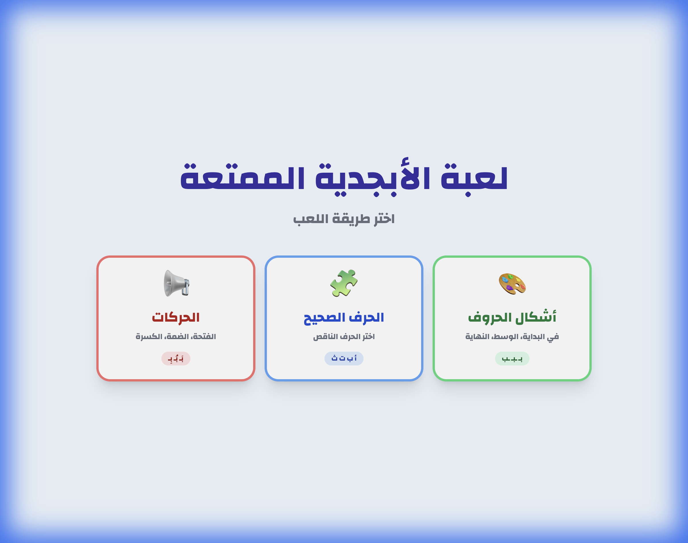

# Arabic Alphabet Game (لعبة الأبجدية الممتعة)

A fun, interactive, and educational web-based game designed to help children learn the Arabic alphabet, letter forms (Initial, Medial, Final, Isolated), vowel signs (Harakat), vocabulary, word writing, and reading through illustrated stories.



## 🎮 Game Modes

The application features six distinct game and learning modes to reinforce different aspects of the Arabic language:

### 1. Missing Letter (الحرف الصحيح) 🧩
Features two levels selectable right on the letter selection screen so both toddlers and older learners can practice:
- **Level 1 — For Young Kids (`المستوى ١ للصغار`, ages 3–4):** Shows only a large, familiar picture/emoji (no word text at all, even after answering) and asks which letter the picture starts with, using easy everyday vocabulary where every word begins with the target letter (`أَرْنَب` 🐰 -> Select `أ`).
- **Level 2 — Missing Letter in Word (`المستوى ٢`):** A "fill in the blank" game showing the picture alongside the word with one missing letter (beginning, middle, or end) to test vocabulary and spelling (`_مَكَة` 🐟 -> Select `س`).

### 2. Shape Mastery (أشكال الحروف) 🎨
Focuses on recognizing how Arabic letters change their shape depending on their position in a word.
- **Goal:** Identify the correct letter form for the given position (Beginning, Middle, End, or Isolated).
- **Example:** Identify the shape of 'Ba' (`ب`) at the beginning of `بَاب` -> Select `بـ`.

### 3. Vowel Signs (الحركات) 📢
Teaches the short vowels: Fatha (`َ`), Damma (`ُ`), and Kasra (`ِ`).
- **Goal:** Select the correct vowel sign for the highlighted letter in the word.
- **Example:** `أُذُن` (Ear) -> Select `أُ` (Damma).

### 4. Word & Image (الكلمة والصورة) 🖼️
A reading and matching game to reinforce vocabulary and independent word recognition.
- **Goal:** Read the displayed Arabic word and match it with the correct image/emoji.
- **4 Progressive Levels:**
    - **Level 1 (`المستوى ١`):** Simple 2–3 letter words using letters from Alif (`أ`) to Zay (`ز`).
    - **Level 2 (`المستوى ٢`):** Words using letters from Alif (`أ`) to Ghain (`غ`).
    - **Level 3 (`المستوى ٣`):** Words covering the entire alphabet.
    - **Level 4 (`المستوى ٤`):** Additional vocabulary words across the entire alphabet.
- **Read-First Mode (`إخفاء الصور في البداية`):** Optional toggle on the level selection screen that hides the image choices initially so learners practice reading the word first, with an in-game eye button (👁️) to reveal or re-hide the images when ready.

### 5. Writing (الكتابة) ✍️
An interactive word-building mode that teaches spelling and how letters connect within words.
- **Goal:** Look at the displayed visual prompt and spell the Arabic word letter-by-letter in order using the full Arabic alphabet keyboard (`أ` to `ي`, including `ا` and `ة`).
- **Experience:** Each selected letter dynamically appears in its proper positional shape (`كِـ ـتَـ ـا ب`) before revealing the complete connected word upon finishing.

### 6. Story Reading (قراءة القصص) 📚
An interactive Story Library (`مكتبة القصص`) featuring illustrated, multi-page children's stories for reading practice.
- **Included Stories:**
    - **Zayd Helps People (`زَيْدٌ يُسَاعِدُ النَاسَ`):** A 9-page illustrated story about kindness and helping others.
    - **Ali Returns to Space (`عَلِي يَعُودُ إِلَى الْفَضَاء`):** An 8-page illustrated space adventure story.
- **Interactive Reader Features:**
    - Dedicated cover page layout and large, readable Arabic sentence cards.
    - Arabic-Indic page numbering (`١`, `٢`, `٣`...) and gentle page-turn sound effects.
    - **Flexible Navigation:** Turn pages using on-screen buttons, RTL touch swipe gestures on mobile/tablets, or keyboard shortcuts (`ArrowLeft` / `Space` for next page, `ArrowRight` for previous page, `Escape` for library).
    - End-of-story celebration modal with options to re-read, return to the story library, or go back to the main menu.

## ✨ Features

- **Complete Alphabet:** Covers all 28 Arabic letters from Alif (`أ`) to Ya (`ي`).
- **Toddler-Friendly Beginner Level:** Picture-only starting-letter mode tailored for ages 3–4 with easy, unmistakable everyday words and zero text distractions.
- **Custom & Quick Letter Selection:** Practice specific letters (minimum 3) in letter-based modes, or flip the **"Select All" (`كل الحروف`)** toggle to practice the entire alphabet at once.
- **Progressive Difficulty & Read-First Option:** 4 vocabulary levels and optional initial image masking in Word & Image mode.
- **Step-by-Step Word Spelling:** Interactive full-alphabet keyboard in Writing mode that displays positional letter shapes as words are built.
- **Illustrated Story Library:** Multi-page storybook reader with touch swipe support, keyboard navigation, and completion rewards.
- **Position Context:** Words for Initial, Medial, Final, and Isolated positions across the alphabet.
- **Clear Koufi Typography:** Uses `Noto Kufi Arabic`, `Reem Kufi`, and `Reem Kufi Fun` for crisp, child-friendly Arabic letterforms and diacritics.
- **Interactive Audio:** Browser-synthesized sound effects for correct/incorrect answers and page-turn chimes using `Tone.js`.
- **Visual Learning:** Rich use of emojis, illustrations, and full-page story artwork (with automatic image fallback handling) to associate words and sentences with meaning.
- **Progress Tracking:** Live score counter and 3-heart lives system (`❤️❤️❤️`) across quiz modes.
- **Responsive RTL Design:** Native Right-to-Left (`dir="rtl"`) layout that works smoothly on desktops, tablets, and mobile devices.
- **Dynamic Gameplay:** Randomized rounds (up to 10 questions) with smart distractors generated from the letters selected by the player.
- **Celebration Animations:** Confetti rewards and completion screens for correct answers, finished rounds, and completed stories.

## 🛠️ Technologies Used

- **HTML5:** Semantic Right-to-Left (`dir="rtl"`) structure.
- **Tailwind CSS & Custom CSS3:** Modern utility-first styling and smooth page/confetti animations (`assets/css/style.css`).
- **JavaScript (ES6+):** Modular game logic, story reader controls, state management, and DOM manipulation (`assets/js/script.js` & `assets/js/data.js`).
- **Tone.js:** Synthesizes audio feedback and chimes directly in the browser without external audio files.
- **Google Fonts:** Uses `Noto Kufi Arabic`, `Reem Kufi`, and `Reem Kufi Fun` for clear, readable Arabic typography.

## 🚀 How to Run

Since this is a static web application, no backend or build step is required!

1. **Clone the repository:**
   ```bash
   git clone https://github.com/sibahajjar/arabic_games.git
   ```
2. **Open the game:**
   Simply double-click `index.html` to open it in any modern web browser (Chrome, Firefox, Safari, Edge).

> **Bonus Game:** The repository also includes **Rowad Al-Fadaa (`رواد الفضاء`)** at `rowad_fada2/index.html`, a standalone space-themed game designed for intermediate Arabic learners.

## 🧩 Customization

You can easily add new words, levels, or stories by editing the data arrays in `assets/js/data.js`:

- `wordListLettersLevel1`: For **Missing Letter — Level 1** (`الحرف الصحيح - المستوى ١ للصغار`, picture-only starting letter for ages 3–4).
- `wordListLetters`: For **Missing Letter — Level 2** (`الحرف الصحيح - المستوى ٢`, fill-in-the-blank word).
- `wordListShapes`: For **Shape Mastery** mode (`أشكال الحروف`).
- `wordListHarakat`: For **Vowel Signs** mode (`الحركات`).
- `wordListMatchLevel1` – `wordListMatchLevel4`: For **Word & Image** mode (`الكلمة والصورة`) levels 1–4.
- `wordListWriting`: For **Writing** mode (`الكتابة`).
- `booksData`: For **Story Reading** mode (`قراءة القصص`), with page images placed in `assets/stories/<story_id>/`.

### Word Entry Format (Modes 1–4)
```javascript
{
    word_id: 101,
    correct_letter: 'أ',
    blank_word: '_رنب',      // Use underscore for blank (omitted in wordListLettersLevel1 & Mode 4)
    full_word: 'أَرنب',       // Reference word (hidden in Level 1; displayed in Mode 4 or after answering)
    position: 'أول الكلمة',
    image_emoji: '🐰',       // Emoji visual
    // or use image_url: 'https://example.com/image.jpg'
}
```

### Writing Mode Format (Mode 5)
```javascript
{
    word_id: 504,
    full_word: 'بَاب',
    image_emoji: '🚪',       // Or image_url
    letters: [
        { letter: 'ب', shape: 'بـ' },
        { letter: 'ا', shape: 'ـا' },
        { letter: 'ب', shape: 'ب' }
    ]
}
```

### Story Entry Format (Mode 6)
```javascript
{
    id: 'my_story',
    title: 'عُنْوَانُ الْقِصَّة',
    subtitle: 'وصف قصير للقصة',
    coverImage: 'assets/stories/my_story/cover page 1.jpeg',
    totalPages: 2,
    available: true,
    badge: 'قصة كاملة ⭐',
    pages: [
        { pageNumber: 1, image: 'assets/stories/my_story/cover page 1.jpeg', text: '' },
        { pageNumber: 2, image: 'assets/stories/my_story/page 2.jpeg', text: 'نَصُّ الصَّفْحَةِ الثَّانِيَة.' }
    ]
}
```

## 📄 License

This project is open-source and available for educational use.